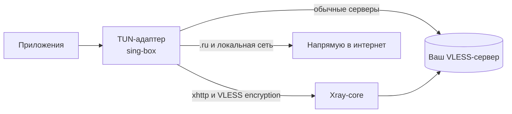

<div align="center">

# Nyxar

### Лёгкий VPN-клиент на Rust для Windows и Android

Вставил ссылку подписки, нажал одну кнопку, и всё работает.<br>
Один файл, живёт в трее, почти не ест память, понимает xhttp.

[](https://github.com/Fersiya/wasd/releases/latest)
[](https://github.com/Fersiya/wasd/actions/workflows/build.yml)


</div>

---

## Почему Nyxar

- **Всё внутри.** Ядро, драйвер и Xray уже вшиты в программу. Скачал, запустил, пользуешься.
- **Работает с современными подписками.** Reality, TLS, WebSocket, gRPC, **xhttp** и VLESS encryption. Что не тянет sing-box, берёт на себя Xray.
- **Лёгкий.** Сам клиент занимает несколько МБ, остальное делает сетевое ядро.
- **Без возни.** Серверы из подписки сразу видны с пингом, режим «Авто» выбирает самый быстрый.
- **Не мешает жить.** Российские сайты и локальная сеть идут напрямую, остальное через туннель.
- **Обновляется сам.** Находит новую версию в релизах, проверяет контрольную сумму и перезапускается.

## Установка

### Windows

Скачай файл из [последнего релиза](https://github.com/Fersiya/wasd/releases/latest):

| Файл | Для чего |
|---|---|
| `Nyxar-Setup-X.Y.Z.exe` | установщик: ярлык в меню «Пуск», удаление через «Приложения» |
| `nyxar.exe` | один файл без установки, можно носить с собой |

Windows попросит права администратора: они нужны, чтобы создать сетевой адаптер.

### Android

Скачай `Nyxar-X.Y.Z.apk` из того же релиза (Android 7.0+, arm64), разреши установку из неизвестных источников и открой приложение.

## Быстрый старт

1. Запусти Nyxar.
2. Вставь ссылку `vless://` или адрес подписки в нижнее поле и нажми **Сохранить и подключить**.
3. Готово. Большая кнопка в центре включает и выключает VPN.

Окно разделено на три вкладки: **Главная** (кнопка, статус, скорость), **Серверы** (список и подписка) и **Настройки**.

Иконка в трее показывает состояние: серая значит «отключено», зелёная «подключено», оранжевая «ошибка». Закрытие окна сворачивает программу в трей, клик по иконке возвращает окно.

## Возможности

| | |
|---|---|
| **Список серверов** | все серверы подписки с честным пингом (TLS-рукопожатие до сервера), выбор одним кликом или «Авто» |
| **Умное соединение** | в режиме «Авто» ядро держит до 5 серверов сразу, проверяет их реальным трафиком и без разрыва уводит соединения с упавшего (Windows) |
| **Автопереключение** | если связь пропала, Nyxar сам переходит на лучший рабочий сервер (Windows) |
| **Программы мимо VPN** | выбираешь из запущенных и установленных программ, они ходят напрямую, остальные через туннель |
| **Статистика** | скорость, трафик и время сеанса на главном экране (Windows) |
| **Раздельное туннелирование** | `.ru`, `.su`, `.рф` и популярные российские сервисы идут напрямую |
| **Обход блокировки Telegram** | встроенный локальный прокси, работает и без VPN (только Windows) |
| **Автозапуск** | старт вместе с Windows и автоматическое подключение |
| **Автообновление** | новая версия ставится сама, когда VPN выключен |
| **Уведомления** | подключение, ошибки и обрыв связи |
| **Аккуратное отключение** | ядро само убирает за собой адаптер и маршруты |
| **Понятные ошибки** | если сервер не подошёл, программа пишет, почему |
| **Лог в окне** | журнал ядра открывается прямо в программе |

### Настройки

| Пункт | Что делает |
|---|---|
| Сервер | выбор сервера из подписки; «Авто» берёт самый быстрый |
| Россия напрямую | российские домены идут мимо VPN |
| Запускать с Windows | создаёт задание в планировщике, программа стартует свёрнутой в трей |
| Подключаться при запуске | сразу поднимает VPN при старте программы |
| Обновлять автоматически | ставит новую версию, когда VPN не подключён |
| Обход блокировки Telegram | запускает локальный прокси `127.0.0.1:1443`; кнопка «Добавить в Telegram» настраивает его в один клик |
| Автопереключение | при пропаже связи перейти на другой рабочий сервер |
| Программы мимо VPN | список процессов (на Android выбор из установленных приложений), идут напрямую |
| Подробный лог | нужен для диагностики, файл быстро растёт |

## Telegram без VPN

Включи переключатель **Обход блокировки Telegram** в окне и нажми **Добавить в Telegram**: клиент предложит подключить прокси, останется подтвердить. Дальше Telegram ходит через Nyxar, остальной трафик не затрагивается.

Внутри работает свой MTProto-прокси: Telegram подключается к `127.0.0.1:1443`, а Nyxar пересылает данные на дата-центр по WebSocket (`kws*.web.telegram.org`), который не блокируется. Идея и протокол взяты из [Flowseal/tg-ws-proxy](https://github.com/Flowseal/tg-ws-proxy). Прокси живёт, пока запущен Nyxar, и не требует включённого VPN.

## Экономия трафика

- **Блокировка рекламы и трекеров.** Рекламные сети и счётчики (около 130 доменов) режутся на уровне VPN: DNS-запрос получает отказ, соединение не начинается. Это меньше трафика и быстрее страницы. Список короткий и осторожный, чтобы не ломать сайты.
- **Трафик по программам.** Nyxar считает, сколько за месяц прошло через VPN у каждой программы, и показывает самые прожорливые. Кнопка «Мимо VPN» пускает программу напрямую одним нажатием.
- **Месячный лимит.** Задай лимит в ГБ: полоска заполняется, при 80% и 100% приходит уведомление.

Счётчики приблизительные: соединение, закрывшееся между двумя опросами (раз в 2 секунды), учитывается без последних байт.

## Умное соединение

Обычный VPN привязан к одному серверу: он упал, и интернет пропал, пока ты не переподключишься. В режиме «Авто» Nyxar поднимает сразу группу из лучших серверов (до пяти, на разных адресах), раз в 40 секунд проверяет каждый настоящим запросом через него самого и ведёт трафик через самый быстрый живой. Если сервер умер или его начали резать, открытые соединения переводятся на соседний сразу, без отключения адаптера и переподключения. На главном экране видно, какой сервер работает сейчас и сколько в резерве, а при переходе приходит уведомление. Если нужен конкретный сервер, выбери его вручную, и группа не используется.

## Как это работает



Весь трафик попадает в виртуальный адаптер. Для большинства серверов его обрабатывает sing-box. Серверы с xhttp sing-box не поддерживает, поэтому Nyxar запускает рядом Xray-core и пропускает трафик через него. Для тебя разницы нет: выбираешь сервер, остальное программа делает сама.

## Частые вопросы

**Подключается, но ничего не открывается.** Включи «Подробный лог», подключись и открой лог в окне. Если там `connection refused` или ошибки сервера, значит, проблема в самом сервере или подписке: попробуй другой сервер из списка.

**В списке нет серверов или пишет «Нет рабочих серверов».** Программа показывает, почему отброшены записи. Чаще всего подписка отдала заглушку вместо серверов: открой её адрес в браузере и проверь, что там есть список.

**Где лежат настройки и логи.** Папка `%LOCALAPPDATA%\Nyxar`, её открывает ссылка «Открыть папку» в окне. Внутри `settings.json`, `config.json`, `sing-box.log` и `xray.log`.

**Telegram не подключается через прокси.** Порт 1443 должен быть свободен: закрой tg-ws-proxy или другой прокси на этом порту. Если Nyxar пишет, что порт занят, выключи и включи переключатель.

**Без сети Nyxar тоже подключается.** Последний удачный список серверов из подписки сохраняется (`subscription.cache`), поэтому при недоступной подписке используется он. Если Nyxar аварийно закроется, ядро и Xray завершаются вместе с ним и не остаются в фоне.

**Можно ли без установки.** Да, `nyxar.exe` работает сам по себе. Если положить рядом файл `portable`, все данные будут храниться рядом с программой.

## Для разработчиков

<details>
<summary>Сборка из исходников</summary>

### Windows

Нужны [Rust](https://rustup.rs) и Windows.

```bat
build_and_run.bat
```

Скрипт скачает ядро, соберёт клиент и сразу запустит его. Либо вручную:

```bat
cargo build --release
```

Готовый файл: `target\release\nyxar.exe`. Положи рядом `sing-box.exe`, `wintun.dll` и `xray.exe`. Чтобы вшить их в один файл, собери с флагом `--features embed` (так делает CI).

### Android

Исходники лежат в папке [`android`](android). APK собирает GitHub Actions: ядро sing-box компилируется в `libbox.aar`, Xray кладётся как `libxray.so`, затем Gradle собирает приложение. Порядок команд смотри в [`.github/workflows/build.yml`](.github/workflows/build.yml). Нужны JDK 17, Go, Android SDK с NDK 28 и `gomobile`.

Подпись APK: если в репозитории есть секреты `NYXAR_KEYSTORE_B64` (keystore в base64) и `NYXAR_KEYSTORE_PASSWORD`, используется этот ключ, иначе создаётся один раз и хранится в кэше Actions. Чтобы обновления всегда ставились поверх, лучше задать секреты.

### Релизы

Каждый пуш в `main` собирает Windows и Android. Если версия из `Cargo.toml` ещё не выпускалась, создаётся релиз с установщиком, одиночным exe и APK.

</details>

## Стек

[`tao`](https://github.com/tauri-apps/tao) · [`wry`](https://github.com/tauri-apps/wry) · [`tray-icon`](https://github.com/tauri-apps/tray-icon) · [`sing-box`](https://github.com/SagerNet/sing-box) · [`Xray-core`](https://github.com/XTLS/Xray-core) · [`wintun`](https://www.wintun.net)
